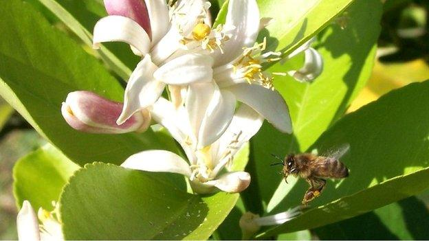
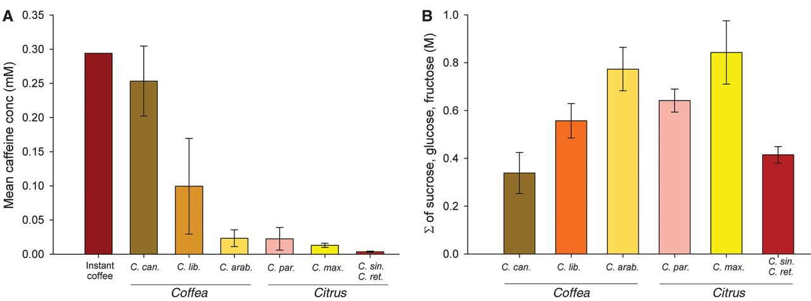
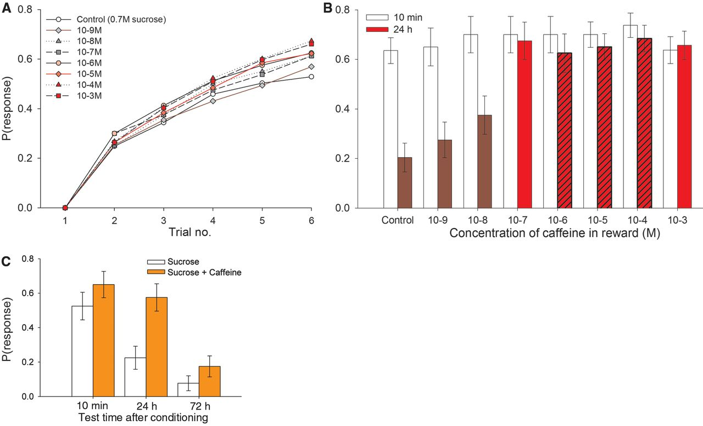

## The Caffeine Story {background-color="#1B4332"}

*L'histoire de la caféine*

::: {.notes}
Transition, ~5 sec. This case study deliberately blurs the honest/
deceptive line just drawn - worth flagging explicitly at the end.
:::

## Caffeine in nectar

<!-- TODO: image of a citrus flower and/or coffee flower. -->

> In 2013 Wright et al. (Science) found caffeine in the nectar of coffee and citrus flowers.
Why do *Coffea* and *Citrus* put caffeine in their nectar?

{width="50%" .nostretch}

::: {.notes}
Ask who had coffee today. Caffeine is an insect-deterring defence compound (Nathanson 1984). That echoes Fraenkel from lecture 1: not waste, but weapon. which are rewards, not defences. 
Collect hypotheses on the board (deter robbers, antimicrobial, manipulate pollinators, side effect)
:::

## The experiment

{width="50%" .nostretch}

{width="50%" .nostretch}

##
- Wright et al. (2013, *Science*): honeybees trained to associate a
  floral scent with a sugar reward — either plain sucrose, or sucrose
  with a low, nectar-realistic dose of caffeine
- Bees that got caffeine were **three times more likely** to still
  remember the scent 24-72 hours later
- Mechanism: caffeine blocks adenosine receptors in the bee brain,
  boosting activity in neurons involved in olfactory learning and
  memory

::: {.notes}
~1.5 min. The dose matters - this is nowhere near the concentration
found in caffeine-rich leaves (which is genuinely repellent/toxic);
nectar caffeine is a carefully calibrated low dose.
:::

## Reward, or manipulation?

<!--

- The bee gets no extra calories, no extra nutrition — just a
  stronger, longer-lasting *memory* of that flower
- The plant gets a more loyal, more faithful pollinator: better
  **floral constancy**, fewer visits "wasted" on competing species
- This isn't deception (the nectar is real) and it isn't simple
  honest reward either (the bee is being cognitively steered, not
  just fed)

**A third category, sitting between honest signaling and outright
deception: manipulating the receiver's own memory to keep the
relationship going.**
-->
::: {.notes}
~1.5 min close. Good note to end the session on - even a genuinely
mutualistic, reward-based relationship can carry a layer of
manipulation. The plant isn't lying about the reward, but it's doing
something to the receiver's brain well beyond "here is some sugar."
:::
