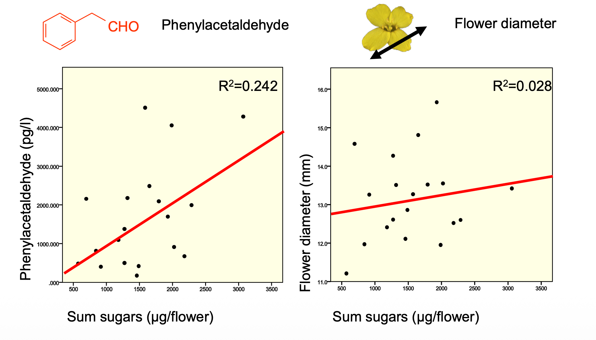
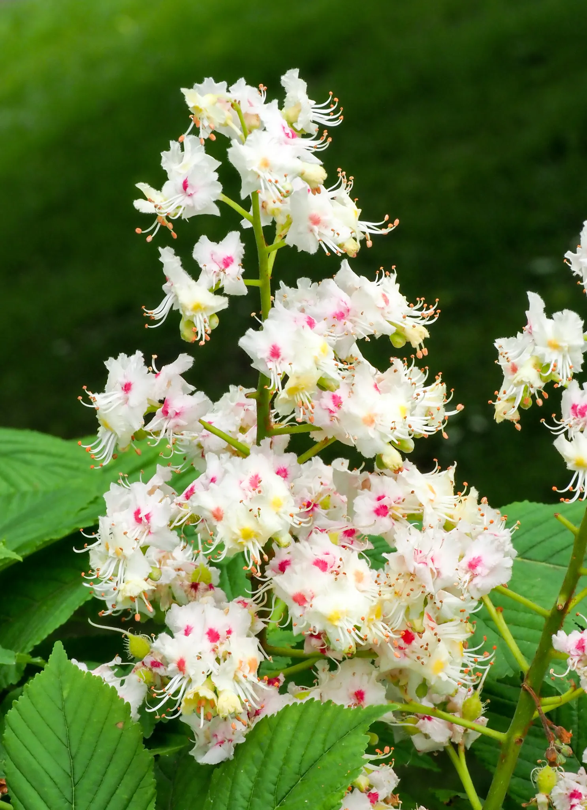
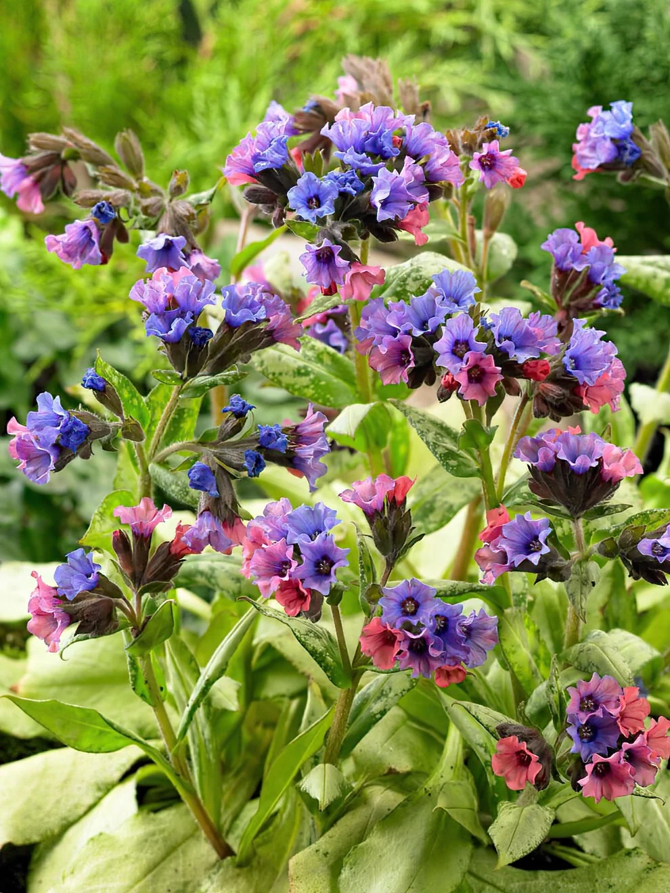
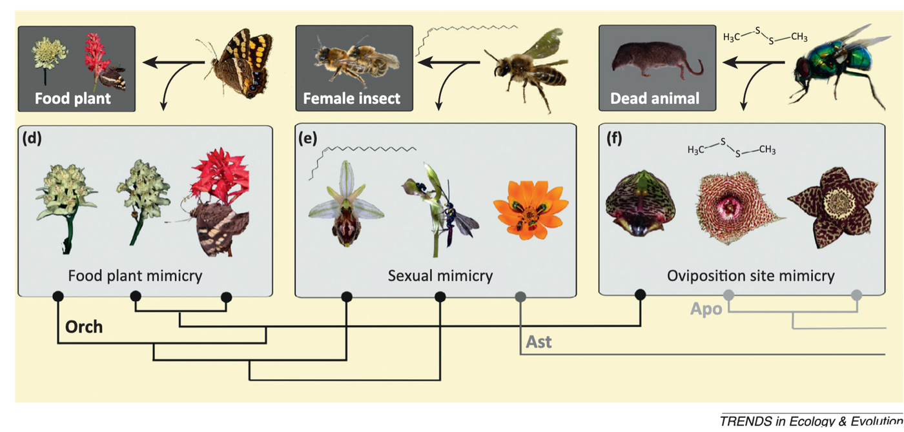
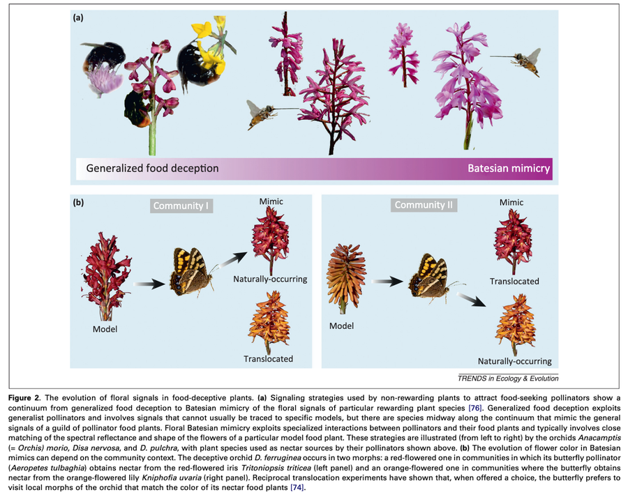
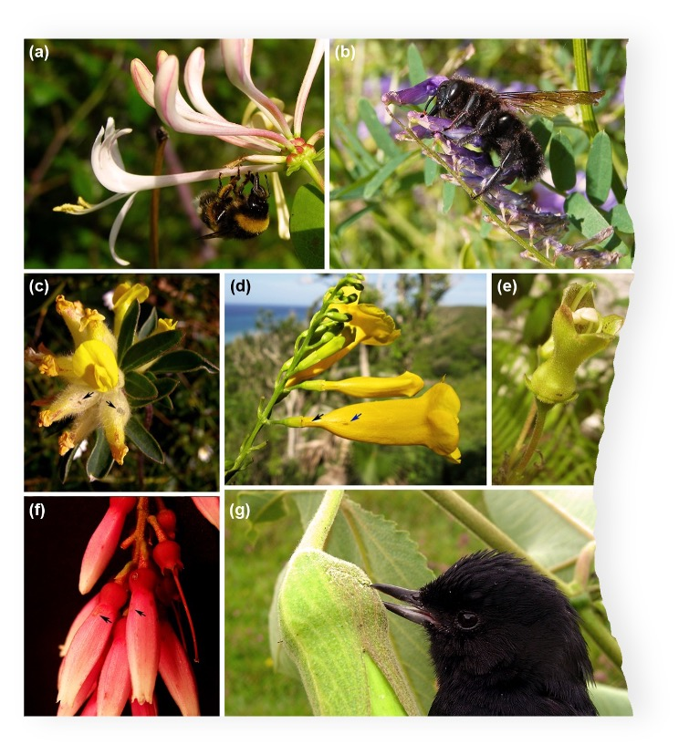
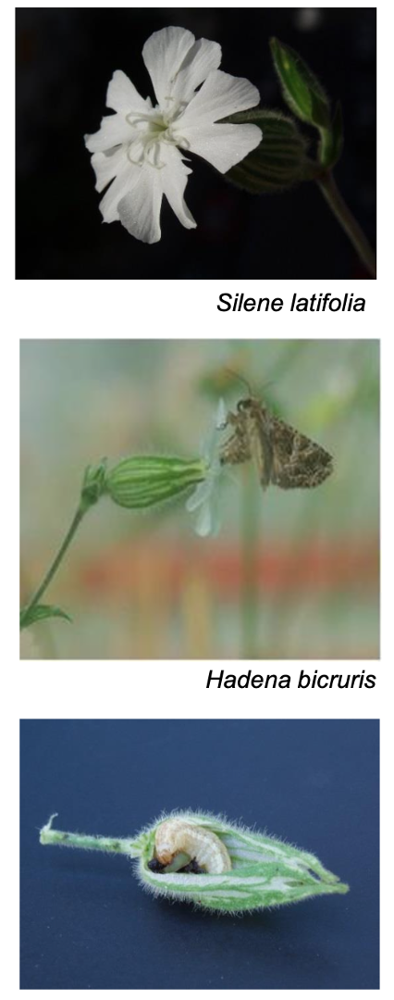
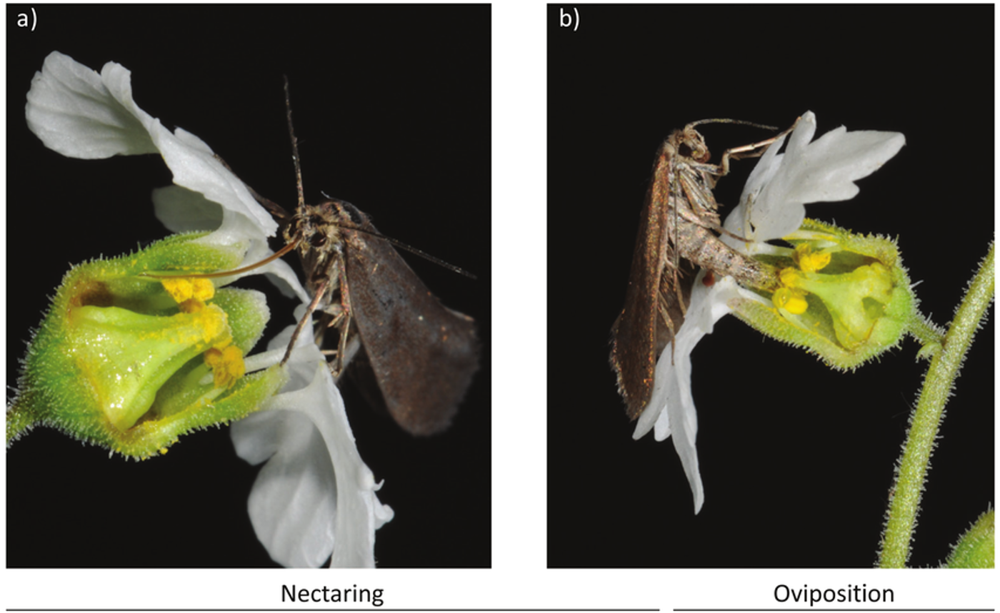
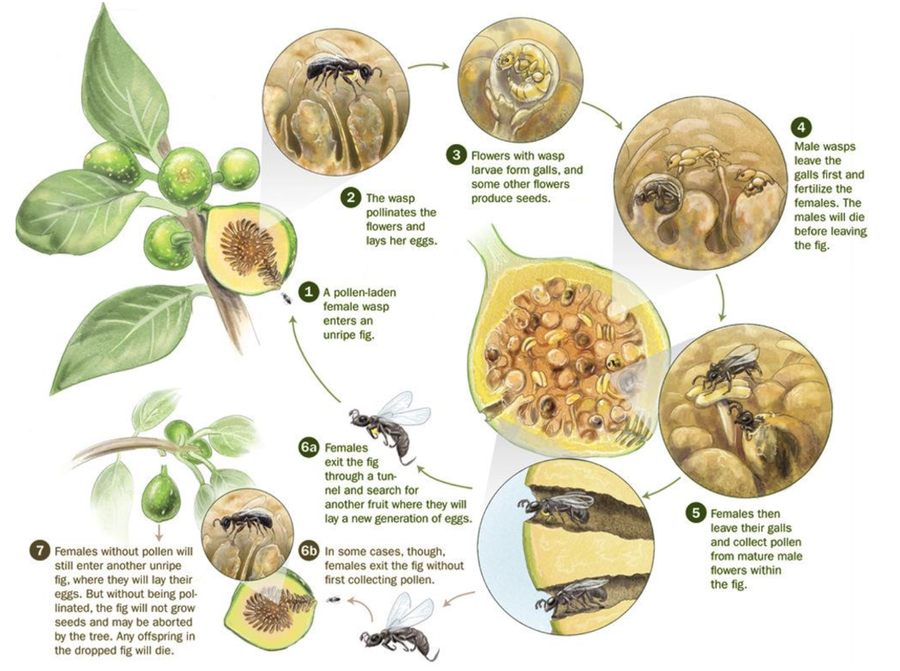
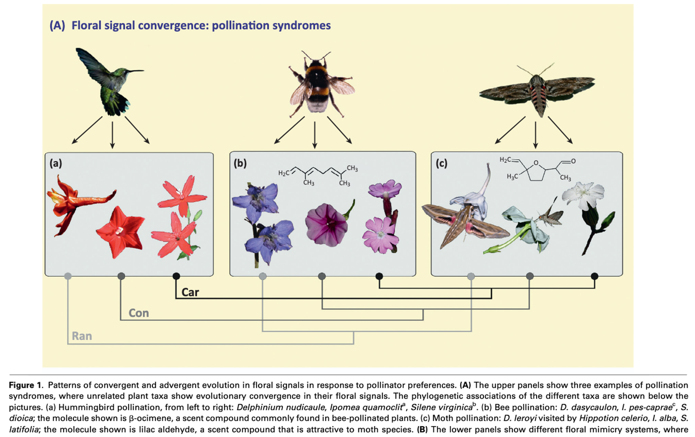

## The Game Between Plants and Pollinators {background-color="#1B4332"}

*Le jeu entre plantes et pollinisateurs*

::: {.notes}
Transition, ~5 sec.
:::

## When signal matches reward: honest signal
::: {.small-text}
- Most flowers advertise truthfully: strong signal usually means a
  real reward, since pollinators learn fast and abandon unreliable
  flowers
- Honest signals can originate directly from rewards (direct honest signals) or be secondarily associated with it
:::

{width="60%" .nostretch}

## 
::: {.small-text}

- color can also be an honest signal: e.g., color change after pollination
:::

:::: {.columns}
::: {.column width="50%"}

{width="80%" .nostretch}
:::

::: {.column width="50%"}
{width="80%" .nostretch}
:::
::::

## When signal doesn’t match any reward: deceptive/mimicry
{width="80%" .nostretch}

::: {.notes}
~1 min. Sets up deception as the exception, not the rule - most of
the marketplace really is honest.
:::

## Three kinds of deception

- **Food deception** — mimicking a rewarding flower's signal while
  offering nothing
- **Sexual deception** — mimicking a female insect's pheromone to trick
  males
- **Oviposition site deception** — mimicking rotting flesh or fungus (e.g.
  *Arum*, carrion flowers) to lure egg-laying flies or beetles

::: {.notes}
~1.5 min. Direct callback to Week 1's Darwin/Coleman Ophrys story -
students already know the example, this names the general phenomenon
it's part of.
:::

##
{width="80%" .nostretch}

## Nectar robbing
Some flower visitors specialize in exploitation, e.g. nectar robbing

{width="40%" .nostretch}

##
- A visitor bypasses the flower's normal entrance — often biting a
  hole at the base of a long corolla tube — and takes nectar without
  touching the reproductive parts at all
- The robber benefits; the plant gets nothing (no pollen moved) and
  loses the nectar it paid for
- **Primary robbers** make the hole; **secondary robbers** just reuse
  one already made by someone else

::: {.notes}
~1.5 min. Nectar robbing is essentially cheating the marketplace -
worth framing explicitly as the reward-side mirror of signal
deception.
:::

## Nursery pollination
:::: {.columns}
::: {.column width="30%"}

{width="80%" .nostretch}
:::
::: {.column width="70%"}

{width="60%" .nostretch}
:::
::::

## 
Fig & fig wasp: Highly specialized nursery pollination
{width="80%" .nostretch}

## 
- Some plants don't just pay with nectar — they offer a **brood
  site**: a safe place for the pollinator's own offspring to develop
- **Yucca & yucca moths**: the moth actively pollinate flowers, then lays eggs in the ovary; larvae eat *some* (not all) of
  the developing seeds
- **Figs & fig wasps**: the fig wasp pollinates while
  laying eggs inside the fig; often one wasp species per fig species,
  a product of coevolution

::: {.notes}
~1.5 min. These are textbook examples of obligate mutualism -
neither species can reproduce without the other, a very different
relationship from the generalist nectar/pollen economy most of today
has covered.
:::

## The evolutionary dance: microevolution

- Within a population, local pollinator preference can shift
  flower color, shape, scent, or reward over a handful of generations
- Different populations of the same species, visited by different
  pollinator communities, can drift toward different floral traits
 

## The evolutionary dance: macroevolution

:::: {.columns}
::: {.column width="40%"}
- Over longer timescales, 
  - **Divergent evolution** of plant species (angiosperm diversity): shifts in pollinators 
  - **Convergent evolution**: pollinator syndromes
:::
::: {.column width="60%"}
{width="90%" .nostretch}
:::
::::

::: {.notes}
~1.5 min. Micro- and macroevolution aren't two different phenomena -
macroevolutionary patterns (new species) are just microevolutionary
shifts (trait change under pollinator-driven selection) accumulated
and fixed over longer time.
:::

## Pollinator syndromes

Convergent suites of floral traits that predict the likely pollinator:

::: {.small-text}
| Pollinator | Color | Scent | Shape/reward |
|---|---|---|---|
| Bee | Blue/purple/yellow, UV patterns | Moderate | Landing platform |
| Moth | White/pale | Strong, sweet, nocturnal | Long tube, nectar-rich |
| Bird | Red | Little to none | Tubular, copious dilute nectar |
| Fly/carrion | Dull purple-brown | Foul | Flat or trap-shaped |
| Bat | Dull | Strong, musty, nocturnal | Robust, copious nectar |
:::

**A useful predictor — but not a perfect one.** 

- Real visitation is often more generalist than the syndrome predicts; 

- Ongoing debate in the field, not settled textbook fact.

::: {.notes}
~2 min. Worth being honest about the controversy (Waser et al. 1996,
"Generalization in pollination systems," pushed back hard on rigid
syndrome thinking) - matches the course's broader habit of flagging
open questions rather than presenting everything as settled.
:::
