## 
How does a sessile plant convince a mobile animal to do the pollination service for it?

:::: {.columns}
::: {.column width="50%"}
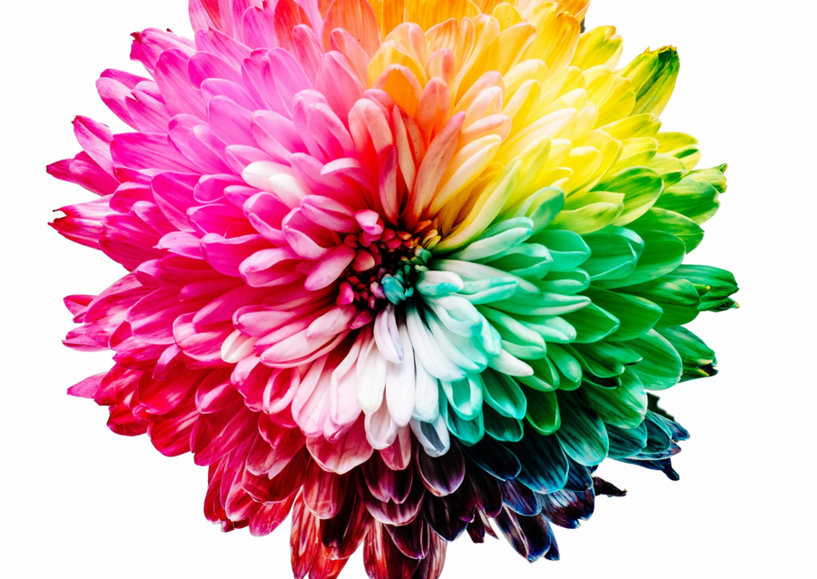{width="100%" .nostretch}
:::
::: {.column width="50%"}
The Flower Is a Marketplace 

*La fleur, un marché*
:::
::::

::: {.notes}
Transition, ~5 sec.
:::

## Signal & Reward

- **Signal** — the advertisement: 
    - Visual: color, shape, size, patterns, UV guides
    - Olfatory: scent (volatiles) 
  > It tells a pollinator *where* something is and *what to expect*
- **Reward** — the actual payment: 
    - Nectar: Primary reward; a sugar-rich solution.
    - Pollen: Protein-rich food. Consumed by bees, some beetles and flies (e.g., hoverflies). 
    - Others: Oils, resins, heat, etc.

  > Reward is what the pollinator is really there for

::: {.notes}
~1 min. Sets up the marketplace framing used for the rest of the
section.

- Like a shop sign vs. the goods on the shelf — most of the time the
  sign should tell the truth, or customers stop coming back
:::

## What is a signal?

- **Signal** is an information source that has **evolved** to transmit information. It evolved through adaptive evolution 

- Different from a **cue**: a source of information that has not evolved for this purpose. It can evolve into a signal, if it carries advantage.

## Is it a signal or a cue? {.hook}

:::: {.columns}
::: {.column width="70%"}
- UV "nectar guide" pattern on a petal
- Leaf greenness, used by a bee as a rough hint of plant vigor
- A flower's scent bouquet indicates the nectar quality
- A flower's scent bouquet mimics insect's sex pheromone 
- The CO2 emission from our body attracts mosquito
- The warmth (temperature) of a flower that's been heating up in the sun
:::
::: {.column width="30%"}
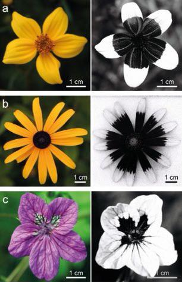{width="80%" .nostretch}

:::
::::

::: {.notes}
~2.5 min with reveal. Direct conceptual callback to Week 2 - a cue,
like a kairomone, benefits only the receiver and didn't evolve for
that receiver's benefit; a signal, like most floral traits, evolved
specifically to communicate.

Answers:
- UV nectar guide -> **signal** (evolved specifically to direct
  pollinators to the reward)
- Leaf greenness -> **cue** (a byproduct of chlorophyll/photosynthesis,
  not evolved to communicate with pollinators, just opportunistically
  read as a hint)
- Scent bouquet -> **signal** (floral volatiles evolved for attraction)
- Sun-warmed flower -> **trick one, discuss**: ordinary passive solar
  warming is a **cue** (incidental, not evolved for communication) -
  but in species with true thermogenesis (e.g. *Arum*, covered later
  today), the SAME kind of warmth becomes a **signal**, since the
  plant is actively producing it to reward/attract visitors. Same
  trait, different evolutionary origin, different category.
- CO2 output difference -> **debated/discuss**: respiration itself is
  a byproduct (cue), but if pollinators reliably exploit it and it
  measurably affects plant fitness, it may be under selection to
  become more detectable - a nice live example of a cue potentially
  evolving toward a signal, matching the definition on the previous
  slide ("it can evolve into a signal, if it carries advantage").
:::

## What is flower color?

- Wavelengths of light that visual system detect. Objects appear to have a specific color because they absorb certain wavelengths of light and reflect others

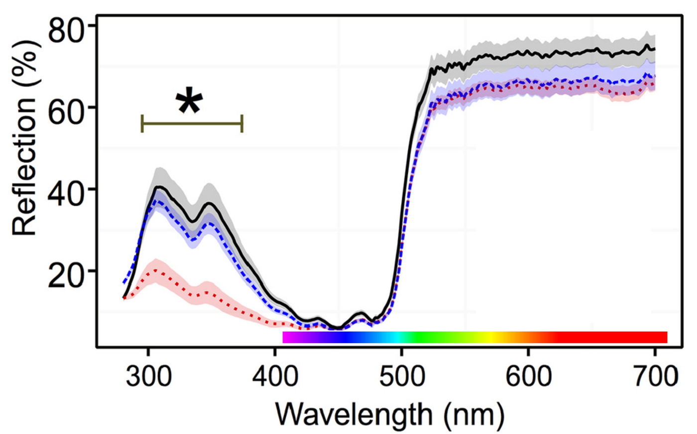{width="60%" .nostretch}

## Mechanisms to give flower the color
::: {.small-text}
- Pigments (chemical, wavelength-selective absorption). e.g., carotenoids absorbs in the blue-green region looks orange/red/yellow to us (those are the wavelengths bouncing back, reflectance)
- pH and ion modulation. e.g., the same anthocyanin molecule shifts red → purple → blue as vacuolar pH rises
- Structural color (physical, pigment-independent): e.g., shiny iridescence
:::

:::: {.columns}
::: {.column width="50%"}
.png){width="100%" .nostretch}
:::
::: {.column width="25%"}
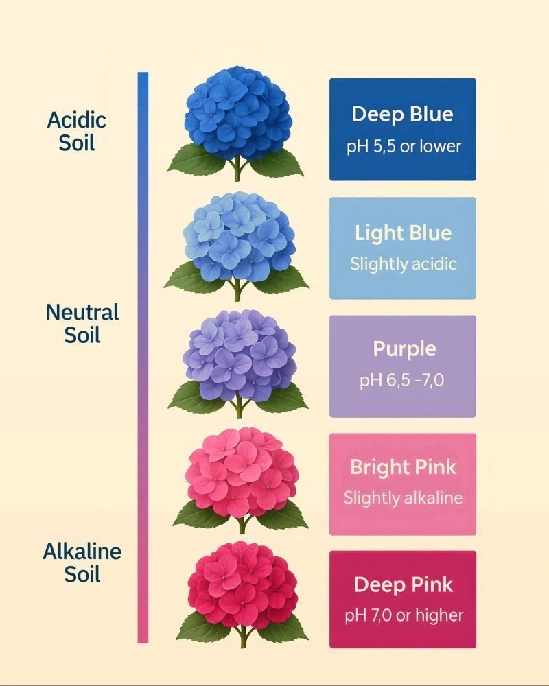{width="100%" .nostretch}
:::
::: {.column width="25%"}
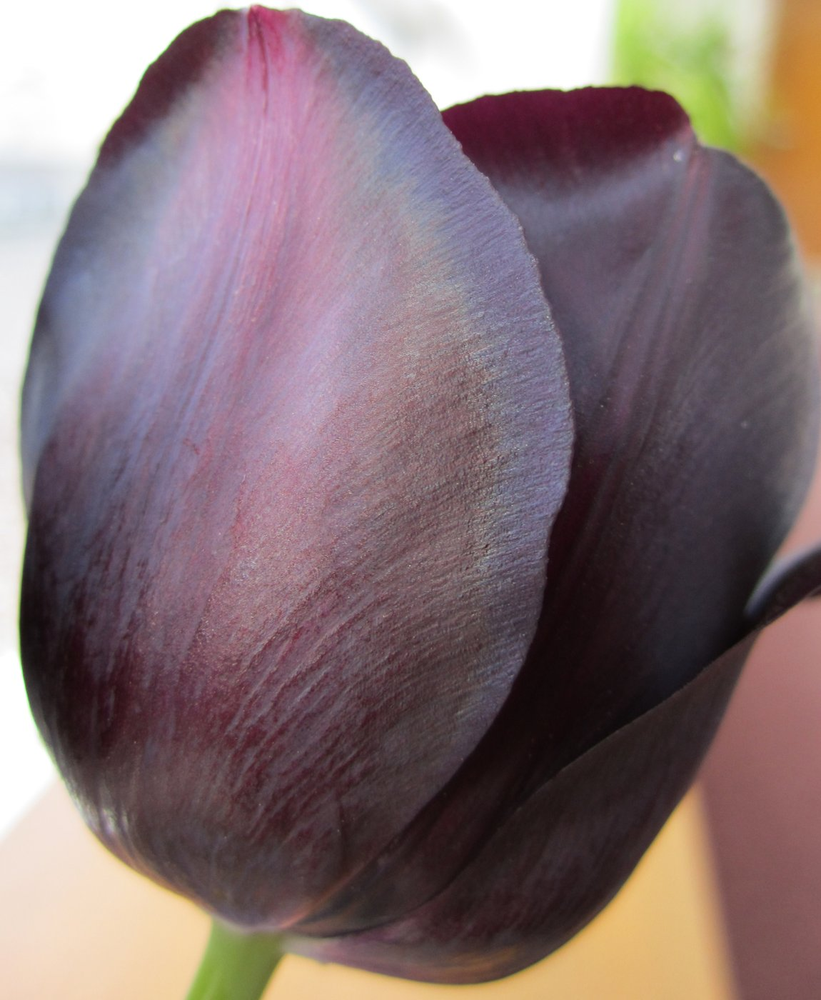{width="100%" .nostretch}
:::
::::

::: {.notes}
~1 min. Worth mentioning bee color vision doesn't include red the way
ours does, but does extend into UV - which is exactly why nectar
guides often only show up in UV photography.

- Pigments: **anthocyanins** (red/purple/blue), **carotenoids**
  (yellow/orange/red), **flavonoids** (including UV-absorbing
  patterns invisible to us but visible to bees)
- Many flowers carry **nectar guides** — patterns (often UV) that
  point a pollinator straight to the reward, like a runway light
:::

## How to measure flower color?

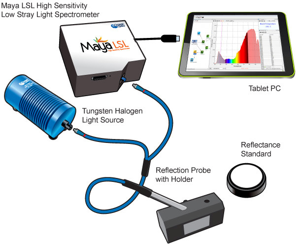{width="50%" .nostretch}

## What is plant scent?
:::{.small-text} 

- Plant volatile organic compounds (VOCs) are a mixture of chemical compounds. 
- They are small molecules with low boiling points and high vapor pressures.
- VOCs can be released from various parts of the plant, including flowers, leaves, stems, roots, and fruits

:::: {.columns}
::: {.column width="70%"}
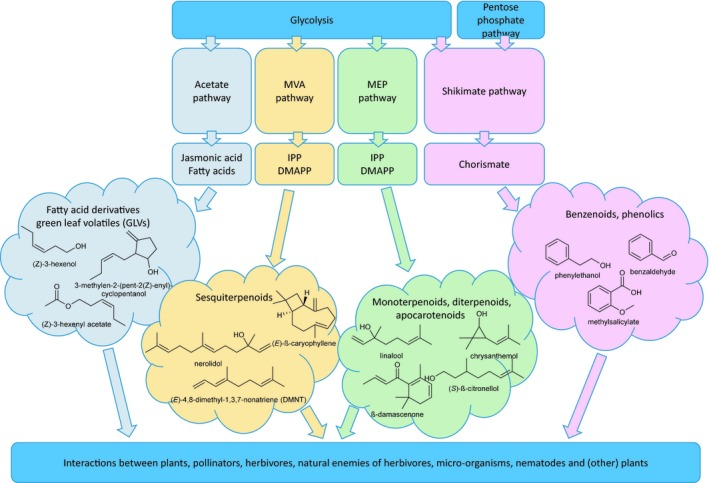{width="80%" .nostretch}
:::
::: {.column width="30%"}

- Diverse Structures: They are derived from different biosynthetic pathways, including terpenoids, benzenoids (aromatic compounds), and fatty acid derivatives and green leaf volatiles.

:::
::::
:::

::: {.notes}
~1 min. Nice full-circle chemistry point: these are often literally
the same compound classes the course has already covered for plant
defense, just redeployed for a different purpose.
:::

## How to measure plant VOCs?
- Collect 
- Analysis (GCMS)

## What is nectar?
:::: {.columns}
::: {.column width="70%"}
- Sugar-rich secretion produced in specialised flower structures (nectaries). 
- Contains also amino acids, fatty acids, ions, secondary metabolites, etc. 

- Not constant composition, with some components almost universal (e.g., main 3 sugars; sucrose, glucose and fructose), and some restricted to particular taxa
:::
::: {.column width="30%"}
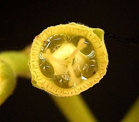{width="100%" .nostretch}

:::
::::

## What is pollen?
:::: {.columns}
::: {.column width="70%"}
- The male gametophyte of flower — but also a **reward**, especially
  for bees, which collect it as a nutrition rich (e.g., protein and lipid) source for larvae
- A real cost for the plant: pollen given away as food is pollen that
  can't go on to fertilize another flower
:::
::: {.column width="30%"}
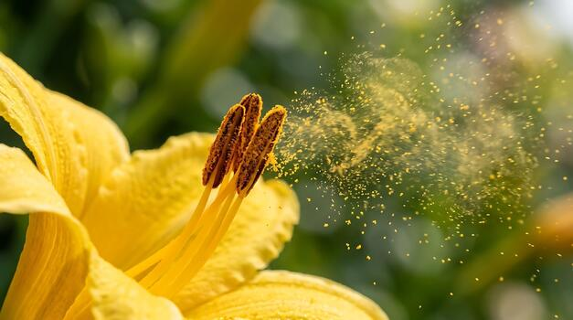{width="100%" .nostretch}
:::
::::

## Other rewards

- **Oils** — collected by specialist oil-bees (e.g. in Malpighiaceae)
- **Resins** — used by some bees for nest construction
- **Fragrance itself** — male orchid bees collect floral scent
  compounds to build their own mating displays
- **Warmth** — some flowers (e.g. *Arum*) generate heat
  (thermogenesis), rewarding visitors with a warm refuge

:::: {.columns}
::: {.column width="50%"}
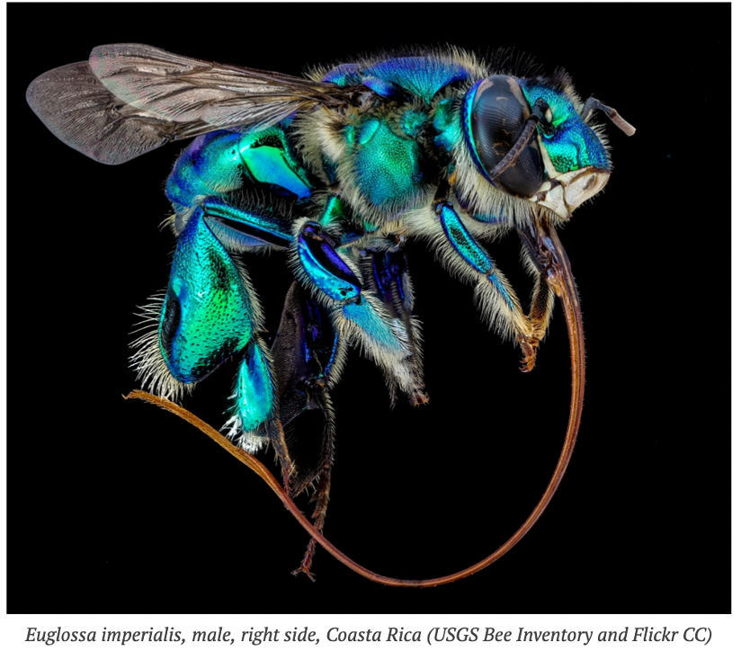{width="50%" .nostretch}
:::
::: {.column width="50%"}
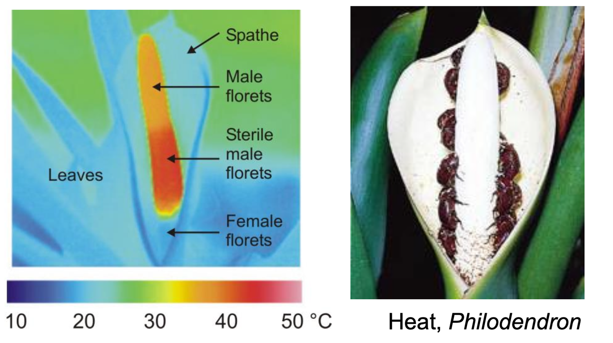{width="80%" .nostretch}
:::
::::

::: {.notes}
~1.5 min. Don't over-explain each - they're here to show the reward
menu is much larger than "nectar and pollen." Brood sites set up the
nursery pollination slide coming up.
:::

## 
What is this?
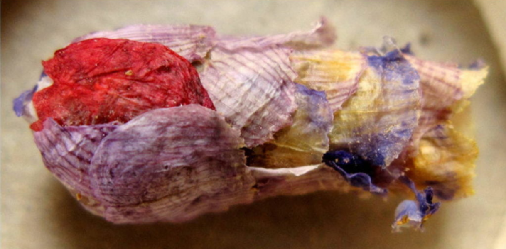{width="100%" .nostretch}

##
.png){width="90%" .nostretch}
